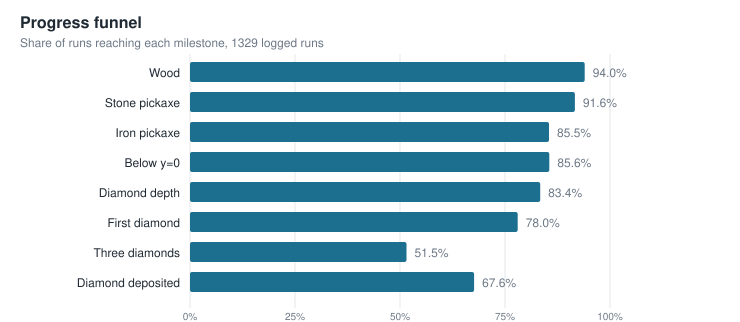
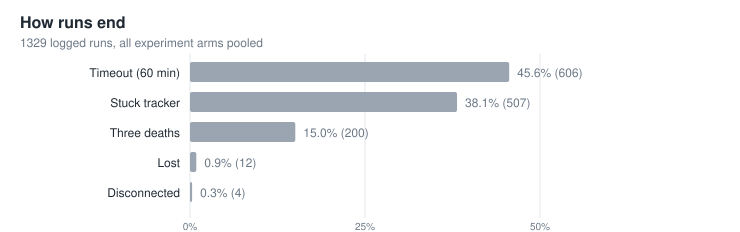
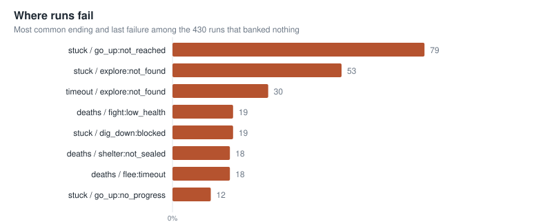
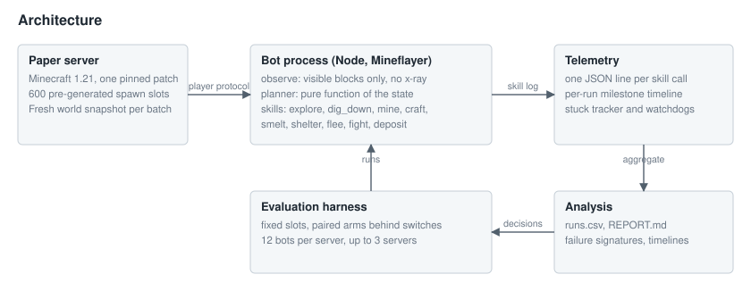
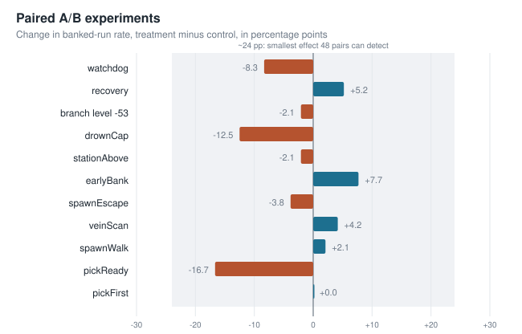

# Minecraft Diamond Agent

A Mineflayer bot that joins a Minecraft Java server, takes an order in chat (`!get diamond max`), mines diamonds
and stores them in a chest, and keeps going until the run ends. Hand-coded skills do the moving, mining and
crafting. A scripted planner chooses the next skill. The repository also contains the evaluation system used to
measure every change: fixed spawn slots, a held-out test set, paired A/B experiments and per-run telemetry.

The work so far covers the scripted baseline (Phases 0 to 2 of [PLAN.md](PLAN.md)). Replacing the planner with a
learned policy (behavior cloning, then reinforcement learning) is planned and has not been started.

## Results

Each run starts at a fixed spawn slot with an empty inventory and lasts at most 60 real minutes or three deaths. A
run succeeds if at least one diamond ends up in the chest. Difficulty is easy, and the world seed is fixed.

| Set | Slots | Success rate | Diamonds banked | Diamonds per hour | Deaths per hour |
|---|---|---|---|---|---|
| Held-out gate (run once) | 0-99 | 71/100 = 71% (95% CI 62-80%) | 424 | 5.52 | 0.98 |
| Dev confirmation | 100-199 | 77/100 = 77% (95% CI 68-85%) | 450 | 5.41 | 1.02 |

The gate required at least 50% success and was passed at commit `402c306`. The development slots were used for
tuning, so the held-out row is the one to trust.



Across all 1,329 logged runs (every experiment arm pooled), most runs reach a first diamond. The runs that bank
nothing mostly stall on the way back to the surface or while looking for ore.

| How runs end | Where runs fail |
|---|---|
|  |  |

## How it works



- **Observation.** The planner sees only what a player could see: inventory, health, food, depth, hostile mobs
  nearby and ore that is both exposed to air and in line of sight. There is no x-ray.
- **Planner.** `bot/planner.js` is a pure function from that observation to the next skill and its argument. It
  follows the tech tree (wood, stone, iron pickaxe), digs down by staircase to about y = -58, branch-mines, and
  returns to deposit when the inventory, pickaxe or food runs low. It keeps a small failure memory so it does not
  repeat a skill that just failed.
- **Skills.** `bot/skills.js` holds `explore`, `dig_down`, `go_up`, `mine`, `craft`, `smelt`, `equip`, `eat`,
  `hunt`, `flee`, `shelter`, `fight`, `deposit` and `return_home`. Each one returns `{ ok, reason, ticks }`, has a
  time cap, is cancelled cooperatively, and is aborted if the bot is attacked.
- **Safety and control.** Chat commands are accepted only from the owner, identified by UUID on online-mode servers.
  Offline-mode servers refuse commands unless explicitly allowed. Dev servers are bound to localhost with a
  whitelist.
- **Telemetry.** Every skill call is logged as one JSON line with arguments, result and state before and after.
  The same log feeds the analysis and is the data format planned for the learned policy.

## Evaluation method

Changing a bot this noisy by feel does not work, so the process is built around measurement.

- **Fixed slots.** 600 spawn points, at least 1,000 blocks apart, each pre-generated to a 256-block radius.
  Slots 0-99 are a held-out gate, 100-199 are for development, and 200-599 are reserved for training data.
- **Fresh world per batch.** The server is stopped, a pristine snapshot is copied over the live world and the
  server is restarted, so every batch sees identical terrain.
- **Paired A/B.** A behaviour change goes behind an environment switch and runs against the control on the same
  slots. The decision rule counts slots where the change was better or worse, not only the average.
- **Capacity measured first.** The number of bots per server (12) was set by benchmarking server tick rate, which
  was the limit, not CPU.
- **Statistics.** Success rates carry bootstrap 95% confidence intervals. With 48 pairs, only an effect of about 24
  percentage points is detectable, and the experiments are read with that in mind.



Most late experiments produced no change that can be told apart from noise, and were rejected and left switched
off, including the watchdog variants, a drowning cap, an early-bank rule, spawn escapes and a spare-pickaxe plan.
Earlier changes with larger effects (shaft descent, crowd fleeing and a bundle of night and relocation rules) were
adopted. The full history, with the slots and counts behind each decision, is in the "Eval history" table of
[PLAN.md](PLAN.md). Analysis reports are in [analysis/out/REPORT.md](analysis/out/REPORT.md), with
decision-by-decision timelines of individual runs in `analysis/out/timelines/`.

## Known limits

- Results hold for one world seed on easy difficulty. Tuning used the development slots.
- About 38% of runs end in the stuck tracker, although many of those had already banked a diamond.
- Open problems: a hill and valley loop in `go_up`, `craft:no_tool` after banking, and spawns in water.
- 24-run experiments can only detect very large effects. Longer paired runs are needed for small ones.

## Roadmap

- Phase 3: a gymnasium environment where one step is one skill, behavior cloning on recorded runs from slots
  200-599, trained and validated with a split by run. Not started.
- Phase 4: PPO fine-tuning as a bounded experiment, with the scripted planner kept as a fallback.

## Repository layout

| Path | Contents |
|---|---|
| `bot/` | Node code: planner, skills, agent loop, chat commands, eval harness, metrics, telemetry |
| `tests/` | Unit tests and live flat-world skill tests (24 files) |
| `server/` | Paper server scripts and configuration for local runs |
| `analysis/` | Aggregated run data, reports, timelines, measurement scripts and `make_figures.py` |
| `docs/` | Behaviour notes, improvement plan, research report and the README figures |
| `PLAN.md` | Design, phases, definitions and the full evaluation history |

## Running it

Requirements: Java 21, Node 24, and a machine with about 14 GB of free disk per pre-generated world copy.
Python with PyTorch (CPU) is only needed for the planned learning phases (`agent/requirements.txt`).

```
cd bot
npm install
npm test                                  # unit tests, no server needed
npm run test:live                         # flat-world skill tests, starts a server
node eval.js <firstSlot> <lastSlot> <bots> <minutes> [instances]
```

World generation is `node bot/pregen.js`, and the pristine snapshot is taken with `node bot/eval.js snapshot`.
Do not run live tests while an evaluation is running. To rebuild the figures from the logged runs, run
`python analysis/make_figures.py` from the repository root. It uses only the standard library.

## Development process

Built with AI coding assistants under written plans, with unit tests and independent review steps (see `CLAUDE.md`
and `.claude/`). The evaluation design, experiments and results are documented in `PLAN.md` and `docs/`.
